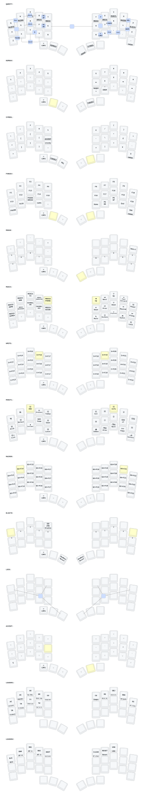
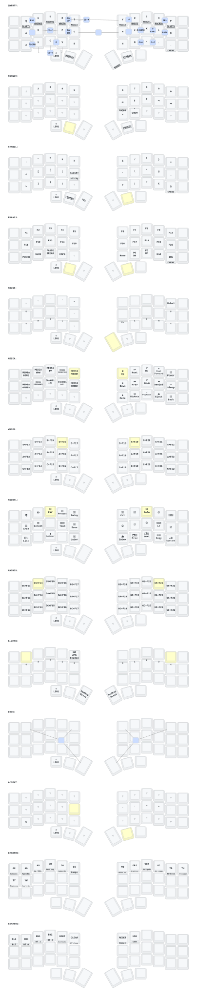
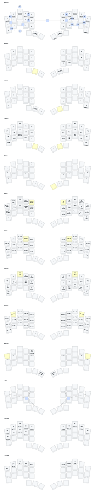
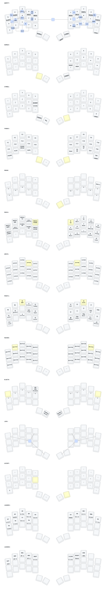

# Heiko's zmk-config for corne / tempest / seppelit / sweep

<!--toc:start-->
- [Heiko's zmk-config for corne / tempest / seppelit / sweep](#heikos-zmk-config-for-corne--tempest--seppelit--sweep)
  - [Overview](#overview)
  - [One layout, four keyboards](#one-layout-four-keyboards)
  - [Repository layout](#repository-layout)
  - [Editing the keymap](#editing-the-keymap)
  - [Verifying a change](#verifying-a-change)
  - [Building and flashing](#building-and-flashing)
  - [Keymaps](#keymaps)
<!--toc:end-->

## Overview

The repo contains my personal ZMK keyboard layout.

I am programming in Python, Rust, Bash/POSIX, and a bit of Java.
At the same time I am writing to almost equal degree in Portuguese, English
and German.

Due to that usage pattern I require quick and easy access to all special characters
and numbers used for programming while also allowing the access quickly the Portuguese
accents and German umlauts.
The Portuguese keyboard layout is the most appropriate to cover all necessary symbols.
While the US or even UK English layout is superior for programming, it does not cover
some Portuguese letters like "ç" (C-Cedilha) nor German Umlauts.

For this reason this ZMK keymap assumes the configuration of a PT (Portugal) keyboard
layout (macOS/Linux/Android).

Both German and Portuguese keyboard layouts are terrible for programming,
but this is taken care of by the layers. There are some layers for specific
applications with bad default support for keyboard centric workflows
(e.g. MS Outlook).

## One layout, four keyboards

All four keyboards share a **single** keymap definition. Each keyboard has a
small adapter file that selects its board macro and includes the shared
sources; nothing is copied or patched per keyboard.

| keyboard | keys | thumbs/side | adapter | why it differs |
|---|---|---|---|---|
| corne (CRKBD) | 36 | 3 | `config/corne.keymap` | 5-column build; selects upstream's `foostan_corne_5col_layout` |
| tempest | 36 | 3 | `config/tempest.keymap` | local shield |
| seppelit | 36 | 3 | `config/seppelit.keymap` | local shield |
| sweep (cradio) | 34 | 2 | `config/sweep.keymap` | two thumb keys fewer |

Shared key positions are written as **zmk-helpers labels** (`LT4`, `LM0`,
`LH0`, …) rather than numbers. Each board's `key-labels` header (`36.h` or
`34.h`) resolves those labels to its own numbering, so one combo definition is
automatically correct on every board. This is what replaces the old
`generate_keymaps.sh`, which replicated the keymap three times and patched
`key-positions` with `grep`/`sed` — a process that failed *silently* whenever a
position was mistyped, because a combo on the wrong keys still compiles.

## Repository layout

```
config/
  include/keys.h          board selection, PT keycodes, layer indices, timing
  include/behaviors.dtsi  hold-taps (&hm/&hms/&urm/&skm), sticky layers, leaders
  include/macros.dtsi     the ZMK_MACRO definitions
  include/combos.dtsi     all combos, in key labels
  include/layers.dtsi     all 12 layers, via ZMK_LAYER_NAMED
  corne.keymap            \
  tempest.keymap           |  thin adapters: board macro + includes
  seppelit.keymap          |
  sweep.keymap            /
  *.json                  keymap-drawer physical layouts
  *-leader.yaml           generated: leader sequences, for the drawings only
scripts/verify_equivalence.py   behaviour regression check
generate_leader_yaml.py         renders leader sequences into virtual layers
```

`config/zmk-helpers` is a symlink into the `zmk-helpers` submodule, pinned to
upstream `main`.

## Editing the keymap

Edit the shared file for anything that concerns all keyboards:

* a key binding → `config/include/layers.dtsi`
* a combo → `config/include/combos.dtsi`
* a macro → `config/include/macros.dtsi`
* a behaviour or leader sequence → `config/include/behaviors.dtsi`

Only edit a `config/<keyboard>.keymap` adapter if that keyboard needs something
genuinely different. Board-specific divergence is written inline with
`#ifdef ZMK_KB_34` (sweep), as in the thumb rows of `layers.dtsi`. Keep such
divergence rare and commented — it is the one place where the "one layout"
guarantee is suspended.

Two rules worth knowing, both learned the hard way:

1. **Layer order in `layers.dtsi` is load-bearing.** keymap-drawer resolves a
   combo's `layers` property by position, so the order of `ZMK_LAYER_NAMED`
   calls must match the layer-index `#define`s in `keys.h` (QWERTY=0 …
   ACCENT=11).
2. **Layer node names must not collide with those `#define`s.** `ZMK_LAYER`
   token-pastes its argument, so `ZMK_LAYER(QWERTY, …)` with `#define QWERTY 0`
   in scope would emit `layer_0` with display-name `"0"`. That is why
   `keys.h` provides `ZMK_LAYER_NAMED(node, "Display Name", …)`, which keeps
   the node name lowercase and the display name verbatim.

## Verifying a change

```sh
./scripts/verify_equivalence.py check --golden .research/golden-pre-refactor.json
```

This compares *expanded behaviour*, not text: the fully preprocessed binding
list of every layer, and the resolved numeric `key-positions` of every combo.
That is the check that catches a combo silently landing on different keys.
`corne`/`tempest`/`seppelit` are compared against the recorded 36-key
reference; `sweep` and `seppelit` additionally get a structural check (12
layers, correct thumb count, expected combo count).

Render the drawings locally with `just draw`. Note `just draw` needs `keymap`
(keymap-drawer) on `PATH`; it writes `img/*.svg` and `img/*.yaml`.

## Building and flashing

`build.yaml` lists all four keyboards, built by
`.github/workflows/build.yml`. Locally, `just build <expr>` filters that file,
e.g. `just build corne`.

## Keymaps

<details>
  <summary>Tempest (36 keys)</summary>


</details>

<details>
  <summary>Corne (5-column CRKBD, 36 keys)</summary>


</details>

<details>
  <summary>Seppelit (36 keys)</summary>


</details>

<details>
  <summary>Sweep (34 keys)</summary>


</details>
