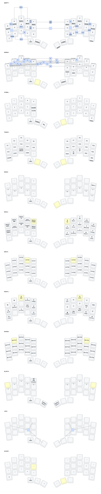
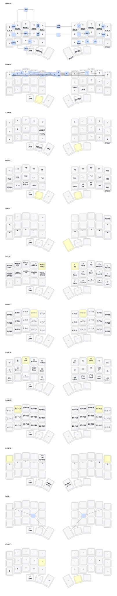
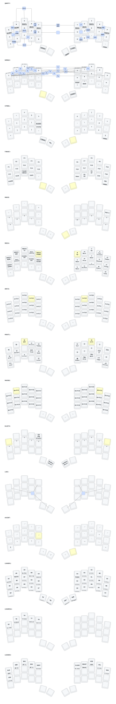

# Heiko's zmk-config for corne / tempest / seppelit / sweep

<!--toc:start-->
- [Heiko's zmk-config for corne / tempest / seppelit / sweep](#heikos-zmk-config-for-corne--tempest--seppelit--sweep)
  - [Overview](#overview)
  - [One layout, four keyboards](#one-layout-four-keyboards)
  - [Leader key: symbols, emoji and text snippets](#leader-key-symbols-emoji-and-text-snippets)
  - [Repository layout](#repository-layout)
  - [Editing the keymap](#editing-the-keymap)
  - [Building and flashing](#building-and-flashing)
  - [Keymaps](#keymaps)
<!--toc:end-->

## Overview

The repo contains my personal ZMK keyboard layout.

I am programming in Python, Rust, Bash/POSIX, and a bit of Java.
At the same time I am writing to almost equal degree in Portuguese, English
and German.

Due to that usage pattern I require quick and easy access to all special characters
and numbers used for programming while also allowing the access quickly the Portuguese
accents and German umlauts.
The Portuguese keyboard layout is the most appropriate to cover all necessary symbols.
While the US or even UK English layout is superior for programming, it does not cover
some Portuguese letters like "ç" (C-Cedilha) nor German Umlauts.

For this reason this ZMK keymap assumes the configuration of a PT (Portugal) keyboard
layout (macOS/Linux/Android).

Both German and Portuguese keyboard layouts are terrible for programming,
but this is taken care of by the layers. There are some layers for specific
applications with bad default support for keyboard centric workflows
(e.g. MS Outlook).

## One layout, four keyboards

All four keyboards share a **single** keymap definition. Each keyboard has a
small adapter file that selects its board macro and includes the shared
sources; nothing is copied or patched per keyboard.

| keyboard | keys | thumbs/side | adapter | why it differs |
|---|---|---|---|---|
| corne (CRKBD) | 36 | 3 | `config/corne.keymap` | 5-column build; selects upstream's `foostan_corne_5col_layout` |
| tempest | 36 | 3 | `config/tempest.keymap` | local shield |
| seppelit | 36 | 3 | `config/seppelit.keymap` | local shield |
| sweep (cradio) | 34 | 2 | `config/sweep.keymap` | two thumb keys fewer |

Shared key positions are written as **zmk-helpers labels** (`LT4`, `LM0`,
`LH0`, …) rather than numbers. Each board's `key-labels` header (`36.h` or
`34.h`) resolves those labels to its own numbering, so one combo definition is
automatically correct on every board. This is what replaces the old
`generate_keymaps.sh`, which replicated the keymap three times and patched
`key-positions` with `grep`/`sed` — a process that failed *silently* whenever a
position was mistyped, because a combo on the wrong keys still compiles.

## Leader key: symbols, emoji and text snippets

The leader key carries far more than the sign-off snippets it started with.
Press it, then a short sequence:

| what | how | example |
|---|---|---|
| **math symbols** | leader, `M`, then the symbol's name | `M S U M` → ∑, `M L E Q` → ≤ |
| **emoji** | leader, `E`, then the name | `E H E A R T` → ❤, `E T H U M B DOT U P` → 👍 |
| **Greek** | leader, `G`, then one letter | `G G` → γ, `G G`+Shift → Γ |
| **sign-offs** | leader, two or three letters | `O B R` → "Obrigado,\nHeiko" |
| **unicode mode** | leader, `U X L/W/M` | switch the input method to Linux/Windows/macOS |

Names follow **typst/LaTeX**, so they are the ones you already type: `sum`,
`approx`, `arrow.r`, `integral`. A `.` in a name is the `DOT` key.

**500 math symbols and 500 emoji are active**; roughly 1,000 more are present
but commented out in the generated files, ready to enable. The full list, with
each symbol's glyph and status, is in [docs/LEADER-SYMBOLS.md](docs/LEADER-SYMBOLS.md).

Where a typst name collides with another, the **LaTeX command** is used instead
— `lt.eq` is `LEQ`, `union.big` is `BIGCUP`, `arrow.r.double` is `RIGHTARROW` —
because that is what a maths user already types.

Note the leader sequences are **not drawn** in the keymap SVGs: at this size
they would paginate into hundreds of virtual layers. The markdown reference
above is the documentation.

### Adding or changing symbols

The two `leader-*.dtsi` files are **generated** from typst's own symbol tables
and must not be edited by hand. To change the set, edit
`scripts/gen_leader_symbols.py` and re-run it:

```sh
./scripts/gen_leader_symbols.py            # 500 math + 500 emoji (default)
./scripts/gen_leader_symbols.py --math 300 # smaller set
```

The generator ranks symbols by usefulness **first**, then resolves conflicts by
renaming rather than dropping (`arrow.r.bar` → `arrowRBar`), and asserts that
nothing is silently lost.

## Repository layout

```
config/
  include/keys.h          board selection, PT keycodes, layer indices, timing
  include/behaviors.dtsi  hold-taps (&hm/&hms/&urm/&skm), sticky layers, leaders
  include/macros.dtsi     the ZMK_MACRO definitions
  include/combos.dtsi     all combos, in key labels
  include/layers.dtsi     all 12 layers, via ZMK_LAYER_NAMED
  include/leader-math.dtsi   GENERATED: math symbol leader sequences
  include/leader-emoji.dtsi  GENERATED: emoji leader sequences
  corne.keymap            \
  tempest.keymap           |  thin adapters: board macro + includes
  seppelit.keymap          |
  sweep.keymap            /
  *.json                  keymap-drawer physical layouts
scripts/verify_equivalence.py   behaviour regression check
scripts/check_macro_nesting.py  devicetree nesting guard
scripts/gen_leader_symbols.py   regenerates the two leader-*.dtsi files
zmk_macro_gen.py                turns typed text into a ZMK_MACRO block
docs/LEADER-SYMBOLS.md          the leader symbol reference (generated)
```

`config/zmk-helpers` is a symlink into the `zmk-helpers` submodule, pinned to
upstream `main`.

## Editing the keymap

Edit the shared file for anything that concerns all keyboards:

* a key binding → `config/include/layers.dtsi`
* a combo → `config/include/combos.dtsi`
* a macro → `config/include/macros.dtsi`
* a behaviour or leader sequence → `config/include/behaviors.dtsi`

Only edit a `config/<keyboard>.keymap` adapter if that keyboard needs something
genuinely different. Board-specific divergence is written inline with
`#ifdef ZMK_KB_34` (sweep), as in the thumb rows of `layers.dtsi`. Keep such
divergence rare and commented — it is the one place where the "one layout"
guarantee is suspended.

Two rules worth knowing, both learned the hard way:

1. **Layer order in `layers.dtsi` is load-bearing.** keymap-drawer resolves a
   combo's `layers` property by position, so the order of `ZMK_LAYER_NAMED`
   calls must match the layer-index `#define`s in `keys.h` (QWERTY=0 …
   ACCENT=11).
2. **Layer node names must not collide with those `#define`s.** `ZMK_LAYER`
   token-pastes its argument, so `ZMK_LAYER(QWERTY, …)` with `#define QWERTY 0`
   in scope would emit `layer_0` with display-name `"0"`. That is why
   `keys.h` provides `ZMK_LAYER_NAMED(node, "Display Name", …)`, which keeps
   the node name lowercase and the display name verbatim.

## Building and flashing

`build.yaml` lists all four keyboards, built by
`.github/workflows/build.yml`. Locally, `just build <expr>` filters that file,
e.g. `just build corne`.

Render the drawings locally with `just draw`; it needs `keymap` (keymap-drawer)
on `PATH` and writes only `img/*.svg` (the intermediate YAML goes to a temp
file).

## Keymaps

<details>
  <summary>Tempest (36 keys)</summary>


</details>

<details>
  <summary>Corne (5-column CRKBD, 36 keys)</summary>


</details>

<details>
  <summary>Seppelit (36 keys)</summary>


</details>

<details>
  <summary>Sweep (34 keys)</summary>


</details>
